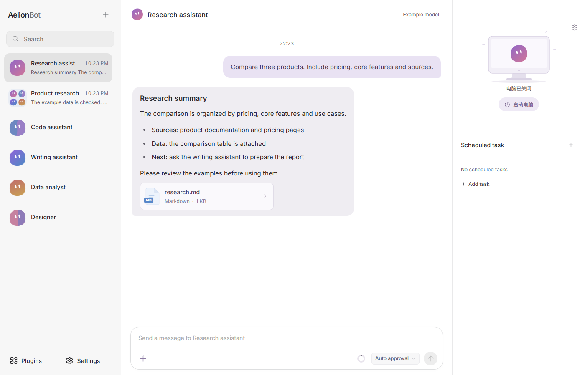
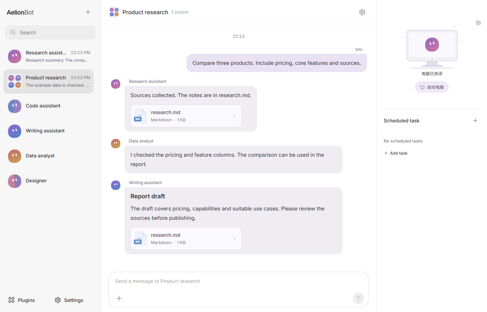
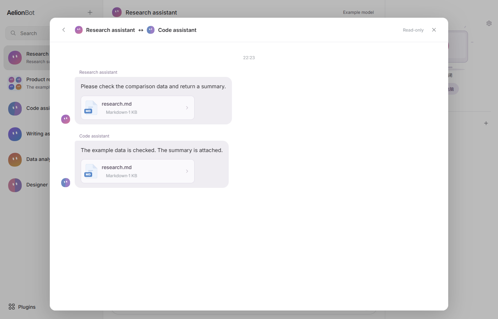
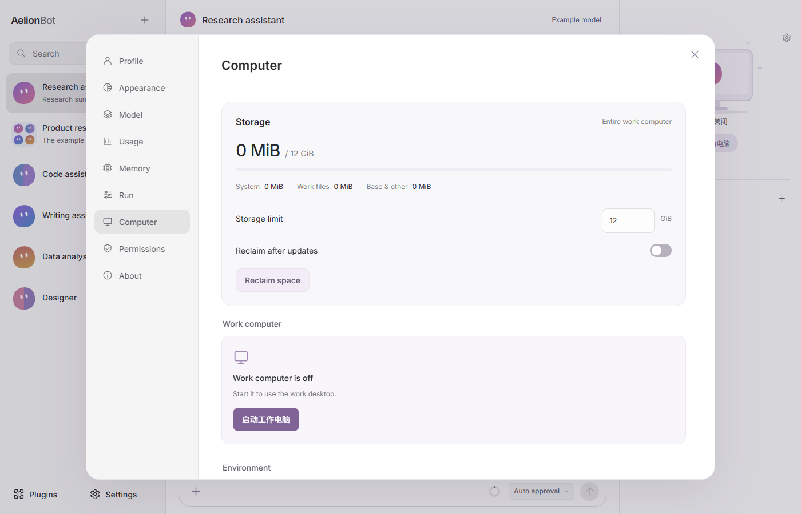

<p align="center">
  
</p>

<h3 align="center">A desktop workspace for multiple AI agents</h3>

<p align="center">
  Give each Bot its own role, model and tools. Hand one a task, or bring several into a group chat.<br>
  Work happens on your own computer, with a managed Linux work computer when a task needs one.
</p>

<p align="center">
  <a href="https://github.com/FoyonaCZY/AelionBot/releases/latest"><strong>Download for Windows / macOS</strong></a> ·
  <a href="https://aelion.chat/?lang=en">Website</a> ·
  <a href="https://aelion.chat/blog/?lang=en">Blog</a> ·
  <a href="README.zh-CN.md">简体中文</a>
</p>

<p align="center">
  <a href="https://github.com/FoyonaCZY/AelionBot/releases/latest"></a>
  <a href="https://github.com/FoyonaCZY/AelionBot/actions/workflows/ci.yml"></a>
  <a href="#terminal-bench-21"></a>
</p>

<br>



## What it does

<table>
  <tr>
    <td width="50%" valign="top"><strong>Multi-agent group chat</strong><br>One partner each for research, data, writing and design. Share files and @ whoever takes the next step.</td>
    <td width="50%" valign="top"><strong>Work sessions</strong><br>Several conversations with the same Bot, each with its own folder, permissions and plan, running at once.</td>
  </tr>
  <tr>
    <td valign="top"><strong>Local work with approvals</strong><br>Read and write files in folders you choose and run commands, under the permission mode you pick.</td>
    <td valign="top"><strong>Linux work computer</strong><br>When a task needs a browser, terminal or office apps, the Bot works in a managed VM you can take over.</td>
  </tr>
  <tr>
    <td valign="top"><strong>Every Bot can design</strong><br>152 design systems and a font library built in, for web prototypes, editable decks and site clones.</td>
    <td valign="top"><strong>Files and previews</strong><br>Web pages, images, PDFs and documents beside the chat. Edit code and text in place.</td>
  </tr>
  <tr>
    <td valign="top"><strong>Connectors</strong><br>Message a Bot from Feishu, WeCom or WeChat and get its final reply back in the chat.</td>
    <td valign="top"><strong>Models, skills and plugins</strong><br>Your own API key or a local model. Eight bundled skills, plus any MCP server.</td>
  </tr>
  <tr>
    <td valign="top"><strong>AI games</strong><br>Twelve-player Werewolf with people and AI at one table. AI personalities grow from game to game.</td>
    <td valign="top"><strong>Command line</strong><br>The same engine runs without the app, in a terminal or an evaluation harness.</td>
  </tr>
</table>

<table>
  <tr>
    <td width="50%"></td>
    <td width="50%"></td>
  </tr>
  <tr>
    <td align="center"><sub>Group work</sub></td>
    <td align="center"><sub>Design canvas</sub></td>
  </tr>
  <tr>
    <td></td>
    <td></td>
  </tr>
  <tr>
    <td align="center"><sub>Task steps</sub></td>
    <td align="center"><sub>Approvals</sub></td>
  </tr>
</table>

## Terminal-Bench 2.1

AelionBot's engine also runs without the desktop app. We ran it on the 89 command-line tasks of [Terminal-Bench 2.1](https://www.tbench.ai/news/terminal-bench-2-1):

| Setup | Pass rate |
| --- | --- |
| **AelionBot + Grok 4.5 (high)**, our run | **82.4%** (220 of 267 trials) |
| Cursor CLI + Grok 4.5 (high), [official leaderboard](https://tbench.ai/leaderboard/terminal-bench/2.1) | 79.3% ±1.5 |

This is our own run with 3 attempts per task, not a leaderboard entry. Its 95% confidence interval, 75.6–89.2%, overlaps the official figure, so read it as on par or better. The method, per-task results and reproduction scripts are in [docs/terminal-bench.md](docs/terminal-bench.md).

<details>
<summary>Run it from the command line</summary>

```sh
pnpm run build
export AELION_API_KEY=...   # read only from the environment
node dist-electron/cli.cjs "Fix the failing tests" --workspace . --model <model> --base-url https://api.example.com/v1
```

`--permission auto` or `full` lets the run approve more on its own, `--timeout <seconds>` limits its length, and `--json` prints a machine-readable result. Anything that needs a person is declined and the result goes back to the model.

</details>

## Get started

1. [Download AelionBot](https://github.com/FoyonaCZY/AelionBot/releases/latest) for Windows or macOS.
2. Connect a model: add an API key, or point it at a local model. The app is free; model usage is billed by the service you choose.
3. Hand a Bot a task. When the work grows, create a group and bring in partners.

Windows 10 or later (64-bit), or macOS on Apple silicon. Intel Macs are not supported. The work computer (Linux VM) needs about 4 GB of memory and tens of GB of disk; 16 GB of RAM or more is recommended.

## In detail

<details>
<summary><strong>Everyday work</strong></summary>

<br>

Open a Bot and say what you need. Searching, reading, writing files and running commands fold into one line under the message, followed by the answer and files. For longer tasks, ask for a plan first (`/plan`) or set a goal the Bot works toward until it is done or blocked (`/goal`).

- **Work sessions**: start one from the "+" menu or a Bot's context menu. Each has its own history, folder, permission mode and plan; long-term memory is shared.
- **Scheduled tasks**: once, daily, weekly or at an interval, run in the conversation that created them while the app is open.
- **Memory and personality**: each Bot has a SOUL.md for its voice and limits, and remembers preferences you confirm.
- Light and dark themes; English, Simplified Chinese and Traditional Chinese.

</details>

<details>
<summary><strong>Working together</strong></summary>

<br>

A group uses only its own messages, materials and files, never unrelated private chats. Partners can message each other and pass files. You decide who does what; the app never reassigns roles on its own.



</details>

<details>
<summary><strong>Local work and approvals</strong></summary>

<br>

Each conversation has its own permission mode:

- **Ask every time**: every local action and MCP call waits for you.
- **Auto approval** (default): ordinary project reads and writes go through; sensitive or out-of-scope actions and MCP calls go to a review model.
- **Full access**: local actions and MCP calls in this session run directly.

"Always allow" saves a command-prefix rule for that folder. Every request says what will run and where.

</details>

<details>
<summary><strong>Work computer (Linux VM)</strong></summary>

<br>

When a task needs a browser, desktop apps or a clean environment, the Bot uses a managed Linux VM with a browser, terminal and office apps. Each Bot has its own folder and desktop; you can watch, pause or take over. Web servers started in the VM can be previewed in the app through port forwarding. Prepare and start it from the in-app guide; storage limits and cleanup are in Settings.



</details>

<details>
<summary><strong>Design</strong></summary>

<br>

Ask any Bot for a prototype, a deck, a site clone, a mobile page or a multi-page document. The design shows in a canvas card beside the chat, without starting a VM.

- **Design systems**: 152 references (color, type, layout and components) ship with the app. The Bot picks one that fits, or none, and asks when unsure. Search, filter or import your own DESIGN.md folder under Settings → Design.
- **Font library**: download Fontsource fonts or import your own; Bots can use them offline.
- **Deliverables**: web work keeps its HTML/CSS/JS; decks are editable PPTX with an HTML preview. Clones include a NOTES.md on sources.
- **Edit in the preview**: mark a region to leave a note, or select an element to change its properties and source.
- Tasks run under `designers/<bot>/<task>` in your default workspace.

Design systems come from OpenDesign's collection with original sources and licenses retained; brand-inspired styles do not imply endorsement. See the [third-party notices](docs/THIRD-PARTY-NOTICES.md).

</details>

<details>
<summary><strong>Connectors</strong></summary>

<br>

Add a Feishu, WeCom or WeChat (experimental) connector on the Plugins page and choose the Bot that replies and its local permissions. The first person who messages it and whom you allow becomes the owner; others pair before they can use it. The Bot sends only its final reply back to the chat, and the app can stay in the tray to keep connectors running after you close the window.

</details>

<details>
<summary><strong>AI games</strong></summary>

<br>

The AI games entry in group chats currently offers twelve-player Werewolf with a sheriff, on two boards: Seer–Witch–Hunter–Idiot and Seer–Witch–Hunter–Guard.

- Play at the table or watch an all-AI game; fill empty seats with temporary Bots and pick a model per AI player.
- Bots have personality profiles: five traits, growth across games, relationships and shared history. Every change shows its evidence and can be undone.
- Games can be paused and resumed, including after the app restarts.


</details>

<details>
<summary><strong>Models, skills and plugins</strong></summary>

<br>

- **Models**: OpenAI-compatible APIs, the Responses API, Anthropic and Gemini, plus local models. Set a default model and a separate approval model; each Bot can have its own model and reasoning effort.
- **Skills**: eight bundled skills for web research, data analysis, documents, spreadsheets, presentations, PDFs, web and interface design, and code.
- **MCP**: add MCP servers on the Plugins page; their tools reach Bots under your permission settings.

</details>

## FAQ

- **Where are my files and chats?** On your computer. Model calls go to the service you choose.
- **Does it work offline?** Bundled design references and downloaded fonts work offline; model services and outside assets usually need a connection.
- **Can it preview Office files?** Decks from design tasks have an HTML version. Other Office files can be previewed once the work computer is running.
- **The download differs from this page?** This page describes the current source; each download follows its release notes.

## Development

Node.js 24 and pnpm (version pinned in `package.json`):

```sh
pnpm install --frozen-lockfile
pnpm run typecheck
pnpm test
pnpm run dev
```

Commit `pnpm-lock.yaml` with dependency changes. Run `pnpm run vm:prepare-runtime` before using the Linux work computer; see [Releasing](docs/RELEASING.md) for building installers.

<p align="center"><sub>
  <a href="https://github.com/FoyonaCZY/AelionBot/releases">Releases</a> ·
  <a href="https://github.com/FoyonaCZY/AelionBot/issues">Feedback</a> ·
  <a href="docs/design-work.md">Design work</a> ·
  <a href="docs/vm-storage.md">VM storage</a> ·
  <a href="website/README.md">Website</a>
  <br><br>
  Screenshots come from the current app; the example conversations and files are made up.
</sub></p>
