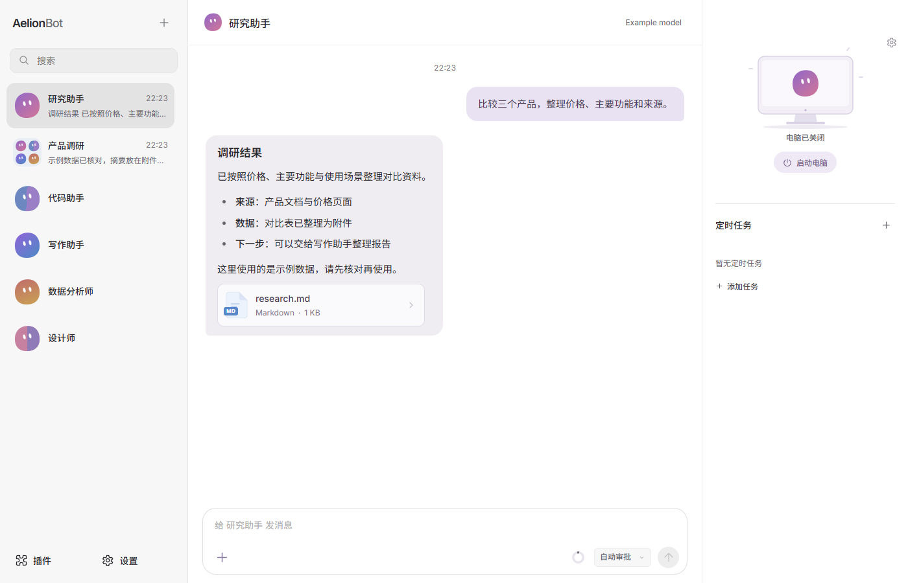
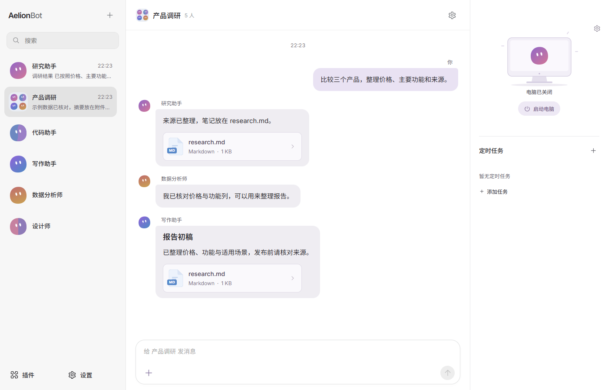
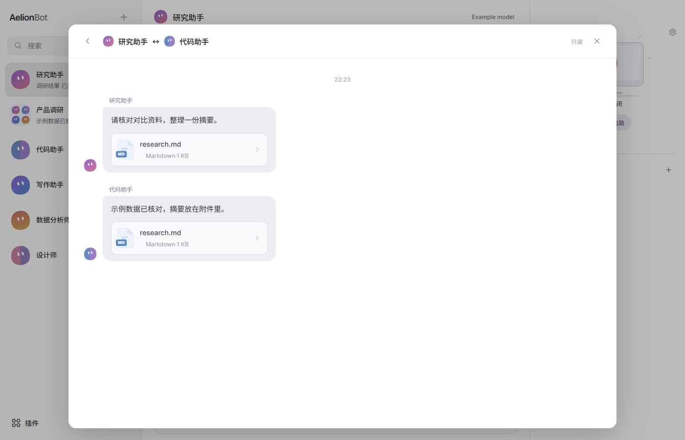
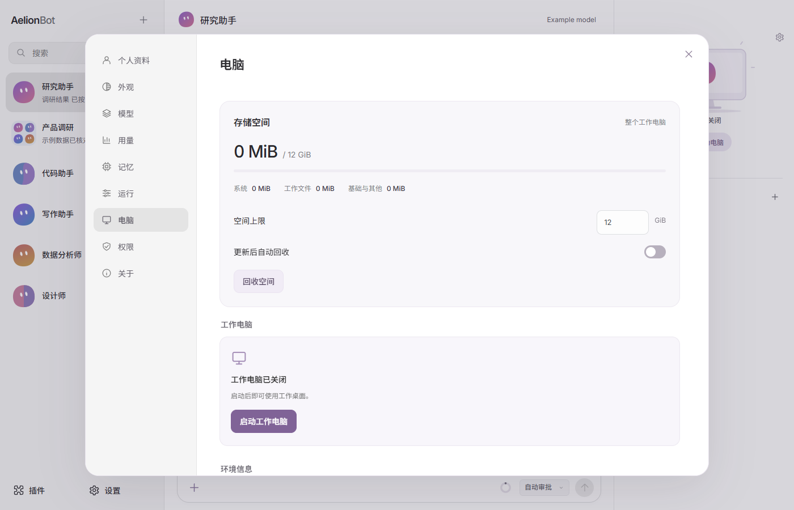

<p align="center">
  
</p>

<h3 align="center">通用多 Agent 桌面工作空间</h3>

<p align="center">
  为每个 Bot 配置职责、模型和工具，一对一交办，或拉进群聊分工协作。<br>
  工作在你自己的电脑上完成，需要时还有一台受管理的 Linux 工作电脑。
</p>

<p align="center">
  <a href="https://github.com/FoyonaCZY/AelionBot/releases/latest"><strong>下载 Windows / macOS 版</strong></a> ·
  <a href="https://aelion.chat/?lang=zh-CN">官网</a> ·
  <a href="https://aelion.chat/blog/?lang=zh-CN">博客</a> ·
  <a href="README.md">English</a>
</p>

<p align="center">
  <a href="https://github.com/FoyonaCZY/AelionBot/releases/latest"></a>
  <a href="https://github.com/FoyonaCZY/AelionBot/actions/workflows/ci.yml"></a>
  <a href="#terminal-bench-21"></a>
</p>

<br>



## 能做什么

<table>
  <tr>
    <td width="50%" valign="top"><strong>多 Agent 群聊</strong><br>调研、数据、写作、设计各安排一位伙伴，共享文件，@ 谁就由谁接手。</td>
    <td width="50%" valign="top"><strong>工作会话</strong><br>同一个 Bot 开多个对话，各有自己的目录、权限和计划，可以同时进行。</td>
  </tr>
  <tr>
    <td valign="top"><strong>本机操作与审批</strong><br>在你指定的文件夹里读写文件、运行命令，按你选的权限模式审批。</td>
    <td valign="top"><strong>Linux 工作电脑</strong><br>需要浏览器、终端或办公应用时，Bot 在受管理的 VM 里工作，你可以随时接管。</td>
  </tr>
  <tr>
    <td valign="top"><strong>每个 Bot 都能做设计</strong><br>152 套设计系统和字体库预装，做网页原型、可编辑 PPT 和网站复刻。</td>
    <td valign="top"><strong>文件与预览</strong><br>网页、图片、PDF 和文档在对话旁预览，代码和文字可以直接改。</td>
  </tr>
  <tr>
    <td valign="top"><strong>连接器</strong><br>在飞书、企业微信和微信里给 Bot 发消息，Bot 完成后把最终回复发回来。</td>
    <td valign="top"><strong>模型、技能与插件</strong><br>自带 API Key 或本地模型；内置八个技能，可以添加 MCP 服务。</td>
  </tr>
  <tr>
    <td valign="top"><strong>AI 游戏</strong><br>十二人狼人杀，真人和 AI 同桌，AI 的性格会跨局成长。</td>
    <td valign="top"><strong>命令行</strong><br>同一套引擎可以无界面运行，适合终端和评测框架。</td>
  </tr>
</table>

<table>
  <tr>
    <td width="50%"></td>
    <td width="50%"></td>
  </tr>
  <tr>
    <td align="center"><sub>群聊分工</sub></td>
    <td align="center"><sub>设计画布</sub></td>
  </tr>
  <tr>
    <td></td>
    <td></td>
  </tr>
  <tr>
    <td align="center"><sub>处理步骤</sub></td>
    <td align="center"><sub>权限审批</sub></td>
  </tr>
</table>

## Terminal-Bench 2.1

AelionBot 的引擎也能脱离桌面应用运行。我们用它跑了 [Terminal-Bench 2.1](https://www.tbench.ai/news/terminal-bench-2-1) 的 89 道命令行任务：

| 配置 | 通过率 |
| --- | --- |
| **AelionBot + Grok 4.5（high）**，我们自己的运行 | **82.4%**（267 次试验通过 220 次） |
| Cursor CLI + Grok 4.5（high），[官方榜单](https://tbench.ai/leaderboard/terminal-bench/2.1) | 79.3% ±1.5 |

这是我们自己的运行，每题 3 次，不是榜单条目。95% 置信区间是 75.6–89.2%，和官方数字有重叠，可以理解为不低于官方成绩。方法、逐题结果和复现脚本见 [docs/terminal-bench.md](docs/terminal-bench.md)。

<details>
<summary>在命令行里运行</summary>

```sh
pnpm run build
export AELION_API_KEY=...   # 只从环境变量读取
node dist-electron/cli.cjs "修好失败的测试" --workspace . --model <模型名> --base-url https://api.example.com/v1
```

`--permission auto` 或 `full` 让这次运行自己批准更多操作，`--timeout <秒>` 限定时长，`--json` 输出机器可读的结果。需要人确认的操作一律拒绝，结果返回给模型。

</details>

## 开始使用

1. [下载 AelionBot](https://github.com/FoyonaCZY/AelionBot/releases/latest)，选择 Windows 或 macOS 版本。
2. 接入模型服务：填 API Key，或连接本地模型。应用免费，模型费用由所选服务收取。
3. 交给 Bot 一件任务。工作变多时建一个群，把伙伴拉进来。

Windows 10 及以上（64 位）或 macOS（Apple 芯片），不支持 Intel 芯片的 Mac。工作电脑（Linux VM）约需 4 GB 内存和几十 GB 磁盘，电脑内存建议 16 GB 以上。

## 功能细节

<details>
<summary><strong>日常工作</strong></summary>

<br>

打开一个 Bot 直接说需求。搜索、阅读、写文件、运行命令等步骤折叠成消息下方的一行，答案和文件放在后面。长任务可以先出计划再执行（`/plan`），也可以设定目标，持续工作直到完成或遇到阻碍（`/goal`）。

- **工作会话**：从“+”菜单或 Bot 的右键菜单新建。每个会话有自己的记录、工作目录、权限模式和计划，长期记忆共享。
- **定时任务**：一次性、每天、每周或按间隔执行，在创建它的对话里运行，执行时需要保持应用开启。
- **记忆与个性**：每个 Bot 有一份 SOUL.md，定义说话方式和边界，也会记住你确认过的偏好。
- 浅色和深色主题；英语、简体中文和繁体中文界面。

</details>

<details>
<summary><strong>多 Agent 协作</strong></summary>

<br>

群聊只用群内的消息、资料和文件，不混入无关的私聊。伙伴之间可以互发私信、传递文件。谁负责什么由你决定，应用不会擅自改变分工。



</details>

<details>
<summary><strong>本机操作与审批</strong></summary>

<br>

每个对话有自己的权限模式：

- **每次询问**：本机操作和 MCP 调用每次都要你允许。
- **自动审批**（默认）：普通项目读写直接放行，敏感、越界的操作和 MCP 调用由审核模型审核。
- **完全访问**：当前会话的本机操作和 MCP 调用直接执行。

“始终允许”会为这个文件夹保存一条命令前缀规则。每个请求都写明要执行什么、在哪里执行。

</details>

<details>
<summary><strong>工作电脑（Linux VM）</strong></summary>

<br>

任务需要浏览器、桌面应用或干净环境时，Bot 使用一台受管理的 Linux VM，里面有浏览器、终端和办公应用。各 Bot 有自己的工作目录和桌面，你可以查看过程、暂停或接管。VM 里的网页服务可以通过端口转发在应用内预览。按应用内引导准备并启动；存储上限和回收空间在设置里。



</details>

<details>
<summary><strong>设计</strong></summary>

<br>

向任何 Bot 要原型、PPT、网站复刻、移动端页面或多页文档。设计稿显示在对话旁的画布卡片里，不需要启动 VM。

- **设计系统**：152 套参考（配色、字体、布局和组件）随应用预装。Bot 按需求挑选，也可以不用，拿不准时会先问你。设置 → 设计里可以搜索、筛选，或导入自己的 DESIGN.md 文件夹。
- **字体库**：下载 Fontsource 开源字体或导入自己的字体，Bot 可以离线取用。
- **交付物**：网页保留 HTML/CSS/JS；演示交付可编辑的 PPTX，带 HTML 预览。复刻任务会写 NOTES.md 说明来源。
- **在预览里修改**：框选区域留下批注，或选中网页元素修改属性和源码。
- 任务在默认工作目录的 `designers/<bot>/<task>` 下进行。

设计系统来自 OpenDesign 的整理资源，保留原始来源和许可；品牌风格参考不代表官方合作，详见[第三方声明](docs/THIRD-PARTY-NOTICES.md)。

</details>

<details>
<summary><strong>连接器</strong></summary>

<br>

在插件页添加飞书、企业微信或微信（实验）连接器，指定回复的 Bot 和本机权限。第一个发消息并被你允许的人成为主人，其他人需要配对后才能使用。Bot 只把最终回复发回聊天，关闭窗口后应用可以留在托盘里保持连接。

</details>

<details>
<summary><strong>AI 游戏</strong></summary>

<br>

群聊里的「AI 游戏」入口，目前是十二人狼人杀（有警长），两个板子：预女猎白和预女猎守。

- 可以真人上桌，也可以旁观全 AI 对局；座位不够时一键用临时 Bot 补齐，每个 AI 玩家可以单独指定模型。
- Bot 有人格档案：五维性格、跨局成长、关系和共同经历。每次变化都能查看依据并撤回。
- 对局可以暂停、恢复，应用重启后也能接着来。


</details>

<details>
<summary><strong>模型、技能与插件</strong></summary>

<br>

- **模型**：兼容 OpenAI 接口、Responses API、Anthropic 和 Gemini，也支持本地模型。可以设置默认模型和单独的审批模型，每个 Bot 也能单独指定模型和推理强度。
- **技能**：内置网页调研、数据分析、文档、表格、演示文稿、PDF、网页与界面设计、代码开发八个技能。
- **MCP**：在插件页添加 MCP 服务，工具按你的权限设置提供给 Bot。

</details>

## 常见问题

- **文件和对话存在哪里？** 在你自己的电脑上。模型调用会连接你选择的服务。
- **离线能用吗？** 预装的设计参考和已下载的字体可以离线使用，模型服务和外部素材通常需要联网。
- **Office 文件能预览吗？** 设计任务生成的演示可以看 HTML 版本；其他 Office 文件在工作电脑启动后可以预览。
- **下载包和这里写的不一样？** 本文描述当前源码，下载包以对应版本的发布说明为准。

## 本地开发

Node.js 24 和 pnpm（版本固定在 `package.json`）：

```sh
pnpm install --frozen-lockfile
pnpm run typecheck
pnpm test
pnpm run dev
```

修改依赖时一起提交 `pnpm-lock.yaml`。使用 Linux 工作电脑前运行 `pnpm run vm:prepare-runtime`；安装包的生成方式见[发布说明](docs/RELEASING.md)。

<p align="center"><sub>
  <a href="https://github.com/FoyonaCZY/AelionBot/releases">版本更新</a> ·
  <a href="https://github.com/FoyonaCZY/AelionBot/issues">反馈建议</a> ·
  <a href="docs/design-work.md">设计工作</a> ·
  <a href="docs/vm-storage.md">VM 存储</a> ·
  <a href="website/README.md">官网开发</a>
  <br><br>
  截图取自当前应用，示例对话与文件是虚构的。
</sub></p>
